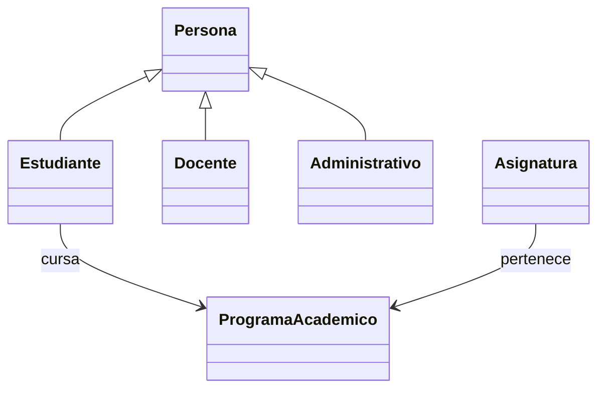

# Guía para comprender y explicar el proyecto

Esta guía acompaña la primera versión funcional del Sistema de Gestión Académica.
Su objetivo es que el estudiante pueda ejecutar el proyecto, seguir los datos
y explicar las decisiones del código. Conviene estudiar una fase a la vez sobre
los mismos archivos; no es necesario crear cinco programas.

## 1 Entender qué representa cada clase

| Clase | Información propia | Relación |
| --- | --- | --- |
| Persona | Identificación, nombre y correo | Clase base |
| ProgramaAcademico | Código, nombre, facultad y semestres | Se relaciona con asignaturas y estudiantes |
| Asignatura | Código, nombre, créditos y programa | Tiene un ProgramaAcademico |
| Estudiante | Código estudiantil, programa, semestre y promedio | Es una Persona |
| Docente | Número de empleado, facultad, contratación y horas | Es una Persona |
| Administrativo | Número de empleado, dependencia, cargo y jornada | Es una Persona |

Una clase define la estructura y los comportamientos. Un objeto es una instancia
con valores concretos. `Ana Torres` y `Carlos Ríos` son dos objetos diferentes de
la clase `Estudiante`; pueden tener distinto programa, semestre y promedio.

El diseño distingue dos relaciones: un estudiante **es una** persona, por eso
hereda; una asignatura **tiene un** programa, por eso guarda una referencia. Una
asignatura no hereda de ProgramaAcademico.



## 2 Seguir el constructor

Abrir `modelos/persona.py` y localizar:

```python
def __init__(self, identificacion, nombre, correo):
    self.set_identificacion(identificacion)
    self.set_nombre(nombre)
    self.set_correo(correo)
```

`__init__` inicializa una instancia recién creada. `self` representa ese objeto
concreto. Los parámetros reciben los valores enviados al construirlo.

El constructor utiliza setters para que un objeto nuevo no pueda comenzar con
un correo vacío. Si el dato es inválido, se lanza `ValueError` y la construcción
no termina correctamente.

Ejemplo del catálogo en `main.py`:

```python
analitica = ProgramaAcademico(
    "PAD", "Ingeniería en Analítica de Datos", "Ciencias e Ingenierías", 8
)
```

`analitica` es una variable que referencia el objeto. Los argumentos inicializan
código, nombre, facultad y semestres, en ese orden.

## 3 Comprender el encapsulamiento

Leer `get_correo()` y `set_correo()` en Persona. El atributo se llama `__correo`.
La consulta usa el getter y la modificación usa el setter:

```python
correo_actual = personas[0].get_correo()
personas[0].set_correo("ana.torres@example.com")
```

El setter evalúa `validar_texto(...)` antes de asignar el resultado. Si la función
detecta una cadena vacía, lanza una excepción y la asignación no se ejecuta. Ese
orden explica por qué el correo anterior se conserva.

El mismo principio se aplica a `set_semestres()` y `set_creditos()`. Revisar
`modelos/validaciones.py` permite ver una sola implementación de la regla para
enteros positivos, compartida por las clases que la necesitan.

Los dos guiones bajos producen una transformación interna del nombre en Python
conocida como *name mangling*. No vuelven imposible el acceso intencional desde
fuera. La disciplina del proyecto consiste en utilizar los métodos públicos y
respetar sus validaciones.

## 4 Reconocer la herencia

En `modelos/estudiante.py`:

```python
class Estudiante(Persona):
    def __init__(self, identificacion, nombre, correo, codigo_estudiantil,
                 programa, semestre, promedio):
        super().__init__(identificacion, nombre, correo)
        self.set_codigo_estudiantil(codigo_estudiantil)
        self.set_programa(programa)
        self.set_semestre(semestre)
        self.set_promedio(promedio)
```

Los paréntesis de `Estudiante(Persona)` expresan la herencia. `super()` permite
invocar la implementación heredada. Persona inicializa los tres atributos
comunes; Estudiante inicializa sus cuatro atributos adicionales.

Un estudiante también puede llamar `get_nombre()`, `set_nombre()` y `set_correo()`
aunque esos métodos no se vuelvan a escribir en su archivo. Los hereda.

Docente y Administrativo siguen el mismo diseño. Sus números de empleado son
datos propios de cada rol; identificación, nombre y correo se mantienen en Persona.

## 5 Explicar la sobreescritura

Persona define los métodos `mostrar_informacion()` y
`realizar_actividad_principal()`. Las tres subclases definen métodos con esos
mismos nombres para especializar la respuesta.

`super().mostrar_informacion()` obtiene el bloque de identificación, nombre y
correo. La subclase agrega los datos que le corresponden. Así se evita duplicar
el formato de la información común.

| Objeto | Resultado de realizar_actividad_principal |
| --- | --- |
| Estudiante | Programa que cursa y semestre en el que se encuentra |
| Docente | Facultad en la que orienta clases |
| Administrativo | Cargo que desempeña y dependencia en la que trabaja |

Los métodos retornan cadenas de texto y el programa principal las imprime. Esa
separación también permite verificar sus respuestas desde las pruebas sin tener
que ejecutar todo el programa.

## 6 Identificar el polimorfismo

Abrir `mostrar_reporte()` en `main.py`:

```python
def mostrar_reporte(personas):
    for persona in personas:
        print(persona.mostrar_informacion())
        print("Actividad principal:", persona.realizar_actividad_principal())
        print()
```

La lista contiene estudiante, docente, administrativo, estudiante, docente y
administrativo. La variable `persona` referencia un objeto diferente en cada
vuelta. Python resuelve qué implementación ejecutar a partir del objeto recibido.

No hace falta escribir una pregunta del tipo «¿es estudiante?» ni cambiar los
nombres de los métodos. Ese es el polimorfismo que exige la actividad.

Los ciclos que imprimen el catálogo de programas y asignaturas no separan a las
personas por rol; el reporte de personas conserva un único ciclo. Los tres
intentos inválidos ocurren antes del reporte y no son una alternativa a ese ciclo.

La prueba `test_reporte_admite_una_nueva_subclase_sin_modificarse` añade un
`Invitado` únicamente en la prueba y verifica que el reporte lo procese. No es una
séptima persona del ejemplo ni una clase adicional exigida por la actividad.

## 7 Recorrer la ejecución completa

1. `main()` llama a `crear_datos_demo()` y recibe programas, asignaturas y personas.
2. Se imprime el catálogo con los valores iniciales: ocho semestres y tres
   créditos para el primer programa y la primera asignatura, respectivamente.
3. Se cambia un correo, el programa pasa a nueve semestres y la asignatura a
   cuatro créditos. Se muestran los valores anteriores y los nuevos.
4. Se intenta reemplazar el correo por `""`, los semestres por `0` y los créditos
   por `-2`. Se muestran tres mensajes de rechazo y los valores conservados.
5. Se actualiza el primer estudiante a semestre 3 y promedio 4.6 mediante
   `actualizar_avance_academico()`. Se intenta luego guardar semestre 4 y promedio
   5.5. La operación se rechaza y se conservan semestre 3 y promedio 4.6.
6. Se recorren las seis personas. Cada una presenta sus datos y su actividad;
   el primer estudiante refleja su avance actualizado.

`try` contiene una operación que puede fallar; `except ValueError as error`
recibe el error previsto y permite informar el motivo. No se utiliza un `except`
genérico que oculte cualquier problema de programación.

## 8 Comprender el aporte y verificar cambios

La mejora incorporada es `Estudiante.actualizar_avance_academico()`, descrita en
[APORTE_INDIVIDUAL.md](APORTE_INDIVIDUAL.md). Leer el método y observar que primero
valida el semestre y el promedio en variables locales. Solo después asigna los
dos atributos privados. Si una validación lanza `ValueError`, no se alcanza
ninguna asignación y el objeto conserva su estado.

La mejora fue implementada con asistencia de IA. Para preparar la sustentación,
seguir el caso válido y el caso rechazado de la sección 4 de `main.py`, y explicar
por qué el semestre tampoco cambia cuando falla únicamente el promedio.

Antes de modificar el código, ejecutar `py main.py` y las pruebas. Después de un
cambio, repetir ambos comandos y revisar el resultado.

Un ejercicio útil es proponer un caso límite que no figure todavía en las pruebas,
decidir qué comportamiento se espera y comprobarlo. Si se descubre una necesidad
real, implementar y documentar la solución. El commit debe reflejar ese trabajo,
con su explicación y las pruebas que correspondan.

Para esta entrega individual, el estudiante debe comprender la totalidad del
proyecto y registrar con precisión los cambios que realice y la ayuda utilizada.

## 9 Preguntas para preparar la sustentación

| Pregunta | Idea que debe poder explicar el estudiante |
| --- | --- |
| ¿En qué se diferencian una clase y un objeto? | La clase define; el objeto tiene valores concretos |
| ¿Qué función cumple __init__? | Inicializa los atributos de cada instancia |
| ¿Por qué el constructor llama setters? | Aplica las mismas validaciones al crear y modificar |
| ¿Qué ocurre al asignar créditos negativos? | Se lanza ValueError y se conserva el dato anterior |
| ¿Qué reutilizan las subclases? | Datos y métodos comunes definidos en Persona |
| ¿Para qué se usa super()? | Para invocar el comportamiento heredado |
| ¿Qué métodos se sobrescriben? | mostrar_informacion y realizar_actividad_principal |
| ¿Dónde está el polimorfismo? | En el único ciclo de mostrar_reporte |
| ¿Por qué el programa se guarda como objeto? | Para compartir la referencia y consultar sus datos actuales |
| ¿Por qué validar antes de asignar los dos datos? | Evita que una validación fallida deje una actualización incompleta |
| ¿Dónde está registrado el aporte? | En el commit enlazado en el README y en APORTE_INDIVIDUAL.md, con la asistencia utilizada |

## 10 Límites de esta versión

El sistema demuestra el modelo de objetos y no guarda cambios entre ejecuciones.
No administra matrículas, calificaciones por asignatura ni autenticación. Son
posibles ampliaciones futuras, pero no se presentan como funcionalidades
implementadas. Los valores de demostración no son datos reales de estudiantes
o trabajadores de la Universidad.
